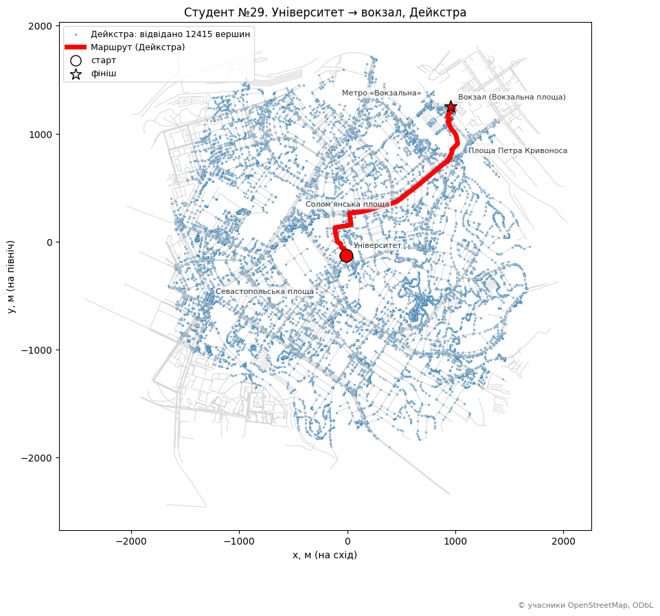
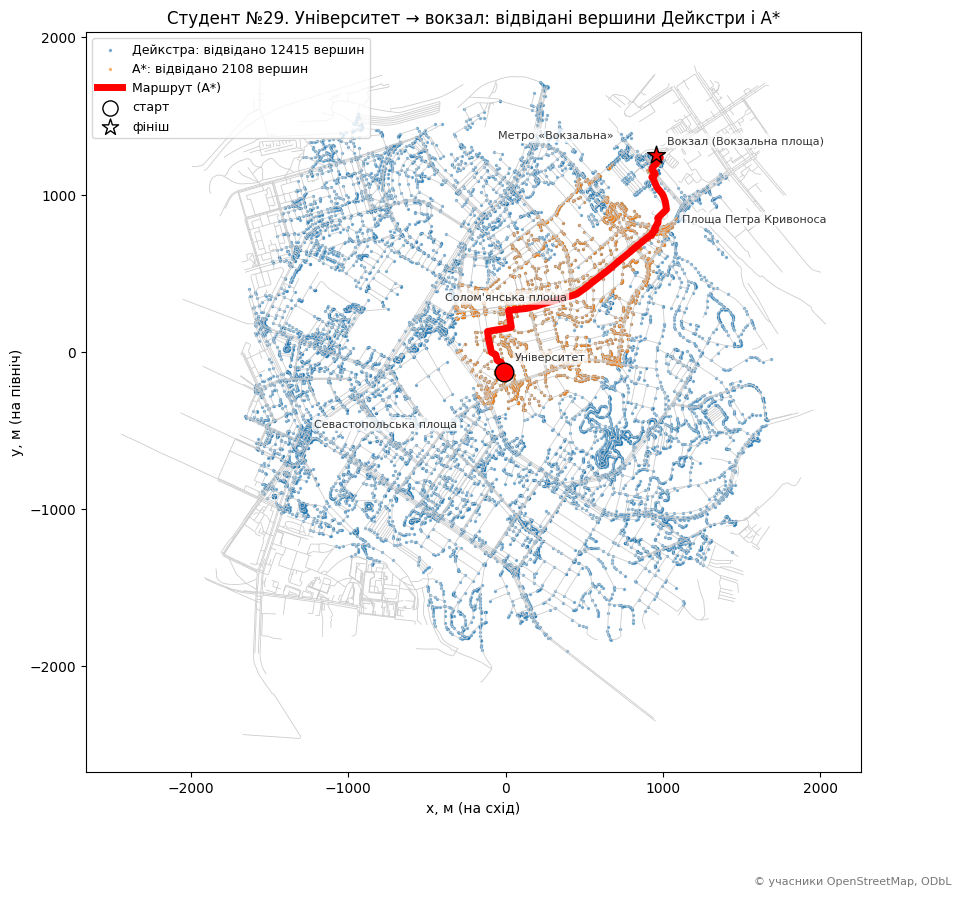
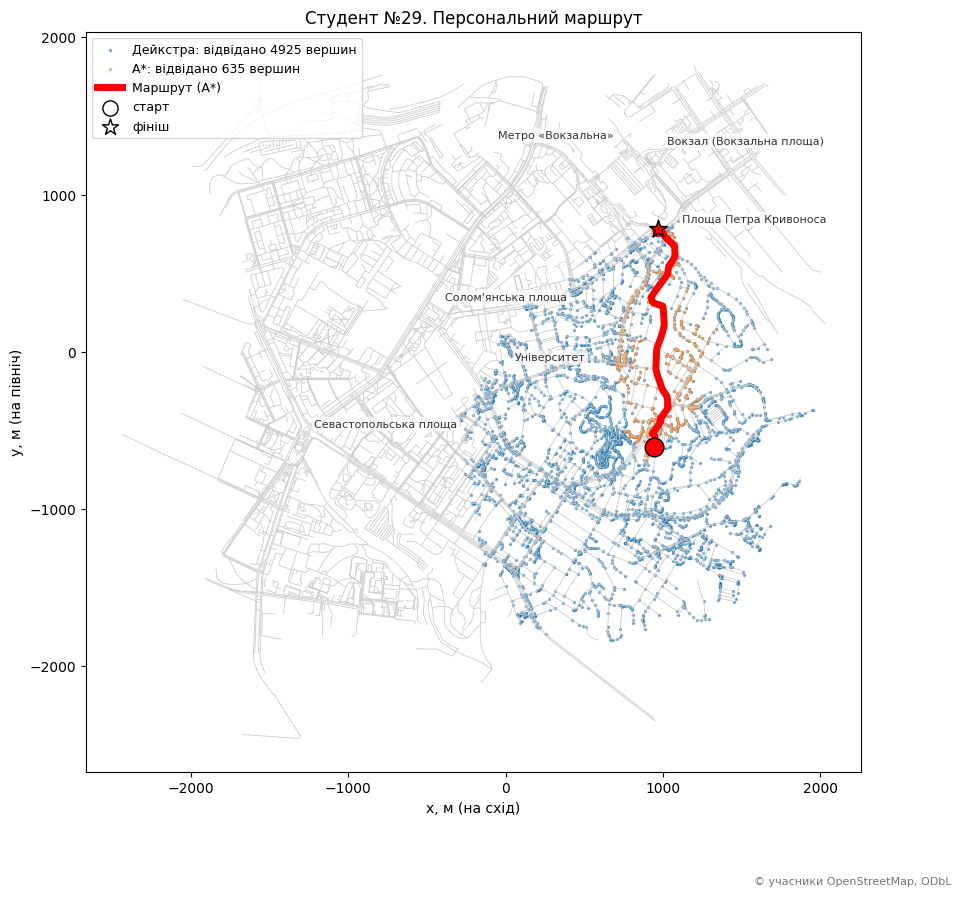
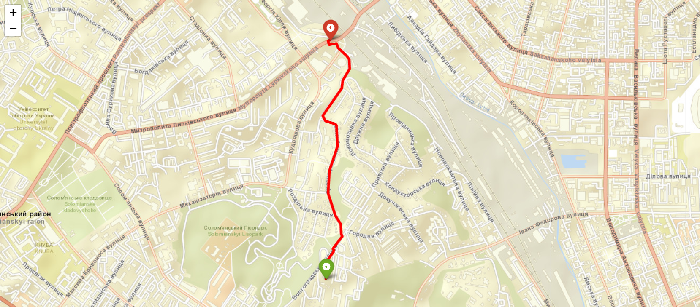
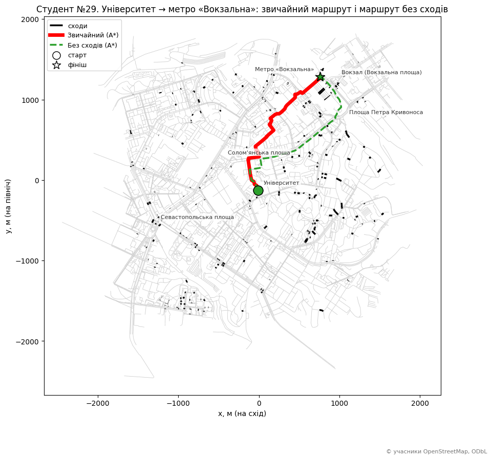

# Побудова маршруту: алгоритми Дейкстри та A* на реальній вуличній мережі

## Запрошені дані

Номер варіанту (`STUDENT_NUMBER`): **29**

Вивід блоку 6 (перевірка реалізації):

```
dijkstra: перевірка пройдена.
astar: перевірка пройдена.
```

Вивід блоку 7 (персональний маршрут):

```
Ваш маршрут: вершина 8600 → вершина 2657, по прямій 1381 м
```

## Експериментальні завдання

### Експеримент 1. Контрольний маршрут: університет → вокзал, алгоритм Дейкстри

**Вивід:**

```
Дейкстра: маршрут 2233 м, по прямій 1684 м, коефіцієнт непрямолінійності 1.33, вершин у маршруті 107, ділянок сходів 0, відвідано вершин 12415
```

**1. Чому маршрут довший за відстань по прямій? Що на карті OpenStreetMap змушує його обходити?**

Відстань по прямій становить $1684\text{ м}$, тоді як довжина знайденого маршруту - $2233\text{ м}$ (коефіцієнт непрямолінійності $1.33$). Пішохід може рухатися лише існуючими вулицями, тротуарами, пішохідними доріжками та переходами, які представлені ребрами графа. На карті OpenStreetMap між університетом і вокзалом розташовані житлові квартали, закриті території, залізничні колії, які не дозволяють пройти навпростець і змушують робити обходи.

**2. Чому алгоритм обробив так багато вершин, хоча маршрут проходить лише через сотню? Яку форму має відвідана область і чому? Де вона обривається сама, а де її обриває межа даних?**

- Алгоритм Дейкстри не має інформації про напрямок до цілі та працює за принципом рівномірного поширення "хвилі" в усі боки від стартової вершини за зростанням пройденої відстані $d(v)$. Оскільки пошук триває доти, доки з черги не буде вийнято ціль, алгоритм встигає обробити всі вершини графа, відстань до яких не перевищує довжину оптимального маршруту ($2233\text{ м}$). Тому замість $107$ вершин самого шляху було оброблено $12\,415$ вершин (майже $78\%$ усього графа).
- На графі відвідана область має форму кола із центром у точці старту.
- **Де область обривається сама:** у напрямку на південний захід/північний захід, де хвиля досягла радіуса, рівного довжині маршруту до вокзалу ($2233\text{ м}$), і пошук зупинився.
- **Де область обриває межа даних:** у напрямку на північ/південь/захід/схід, де хвиля впритул дійшла до краю завантаженого фрагмента карти розміром $3 \times 3\text{ км}$, за межами якого вершини в графі відсутні.



---

### Експеримент 2. Той самий маршрут, алгоритм A*

**Вивід:**

```
A*: маршрут 2233 м, по прямій 1684 м, коефіцієнт непрямолінійності 1.33, вершин у маршруті 107, ділянок сходів 0, відвідано вершин 2108
```

**1. Чому A* гарантовано знаходить маршрут тієї самої довжини, що й Дейкстра?**

При вазі евристики $w = 1$ функція $h(v)$ (відстань по прямій за формулою гаверсинуса) є **допустимою** (ніколи не переоцінює реальну відстань до цілі, бо найкоротший шлях на площині/сфері - пряма, а довжини ребер обчислені тією самою формулою) та **консистентною (монотонною)** (виконується нерівність трикутника $h(v) \le w(v,u) + h(u)$). Завдяки цим двом властивостям оцінка $f(v) = g(v) + h(v)$ уздовж будь-якого шляху не спадає, а в момент виймання цілі з черги з пріоритетом $h(\text{goal}) = 0$, тому $f(\text{goal}) = g(\text{goal})$ гарантовано дорівнює мінімально можливій довжині маршруту ($2233\text{ м}$).

**2. За рахунок чого A* відвідує менше вершин? Чому його відвідана область не є вузькою смугою вздовж прямої "старт — ціль"?**

- A* упорядковує чергу за сумою $f(v) = g(v) + h(v)$, що надає пріоритет вершинам, які не просто близькі до старту, а й наближають пошук до цілі. Через це алгоритм не витрачає час на дослідження напрямків, протилежних до вокзалу, скоротивши кількість відвіданих вершин у $\approx 5.9$ раза (з $12\,415$ до $2108$).
- Відвідана область не перетворюється на вузьку лінію, оскільки A* обробляє всі вершини, для яких виконується умова $g(v) + h(v) \le L^*$, де $L^* = 2233\text{ м}$ - довжина найкоротшого маршруту. Геометричним місцем точок на площині, сума відстаней від яких до двох заданих точок (старту й цілі) не перевищує сталу величину $2a = 2233\text{ м}$ (при відстані між фокусами $2c = 1684\text{ м}$), є **еліпс** (з урахуванням викривлень реальної вуличної мережі). Саме тому досліджена область має характерну витягнуту еліпсоподібну форму.



---

### Експеримент 3. Персональний маршрут

**Вивід:**

```
Дейкстра: маршрут 1633 м, по прямій 1381 м, коефіцієнт непрямолінійності 1.18, вершин у маршруті 70, ділянок сходів 4, відвідано вершин 4925
A*: маршрут 1633 м, по прямій 1381 м, коефіцієнт непрямолінійності 1.18, вершин у маршруті 70, ділянок сходів 4, відвідано вершин 635
```

**1. Зведена таблиця для експериментів 1–3:**

| Маршрут | Алгоритм | Довжина, м | Відстань по прямій, м | Коефіцієнт непрямолінійності | Відвідано вершин |
| --- | --- | --- | --- | --- | --- |
| Контрольний (Університет → Вокзал) | Дейкстра | 2233 | 1684 | 1.33 | 12 415 |
| Контрольний (Університет → Вокзал) | A* | 2233 | 1684 | 1.33 | 2108 |
| Персональний (`[START]` → `[GOAL]`) | Дейкстра | 1633 | 1381 | 1.18 | 4925 |
| Персональний (`[START]` → `[GOAL]`) | A* | 1633 | 1381 | 1.18 | 635 |

**2. У скільки разів A* скоротив пошук у вашому маршруті і в контрольному? Від чого залежить цей виграш? Подивіться, що лежить між стартом і ціллю на рисунку.**

- У контрольному маршруті A* скоротив кількість відвіданих вершин у **$\frac{12\,415}{2108} \approx 5.89$ раза**.
- У моєму персональному маршруті виграш склав **$\frac{[\text{Дейкстра}]}{[\text{A*}]} \approx 7.76$ раза**.
- **Від чого залежить виграш:** величина скорочення пошуку напряму залежить від геометрії вуличної мережі та **коефіцієнта непрямолінійності** маршруту (а також від розташування старту відносно країв карти). Чим пряміші вулиці з'єднують старт і ціль, тим ближча евристика $h(v)$ до реальної залишкової відстані і тим вужчий "еліпс" пошуку A*. Якщо ж між точками є значні перешкоди, які змушують робити великий гак, A* змушений розширювати зону пошуку в сторони.
- На рисунку між моїм стартом і ціллю розташовані парки через що маршрут іде майже прямо, оскільки більшість парків можна пройти наскрізь.



---

### Експеримент 4. Вага евристики

**Вивід:**

```
h_weight =   0: маршрут 1633 м (+0.0 % до найкоротшого), відвідано вершин 4925
h_weight =   1: маршрут 1633 м (+0.0 % до найкоротшого), відвідано вершин 635
h_weight = 1.5: маршрут 1705 м (+4.4 % до найкоротшого), відвідано вершин 94
h_weight =   3: маршрут 1751 м (+7.2 % до найкоротшого), відвідано вершин 82
```

**1. Таблиця результатів для різних значень `h_weight`:**

| `h_weight` ($w$) | Довжина, м | Приріст до найкоротшого, % | Відвідано вершин |
| --- | --- | --- | --- |
| 0 | 1633 | 0.0% | 4925 |
| 1 | 1633 | 0.0% | 635 |
| 1.5 | 1705 | 4.4% | 94 |
| 3 | 1751 | 7.2% | 82 |

**2. Чому за `h_weight > 1` A* втрачає гарантію найкоротшого маршруту? Чому у вашому маршруті приріст набагато менший за гарантовану межу (50 % за 1,5; 200 % за 3)?**

- **Втрата оптимальності:** при $w > 1$ зважена евристика $w \cdot h(v)$ порушує умову допустимості - вона починає **переоцінювати** реальну відстань до цілі на тих ділянках, де вулиці ведуть до фінішу майже по прямій. Пошук стає занадто "жадібним": алгоритм першим ділом прямує до цілі манівцями чи неоптимальними вулицями з меншим $h(v)$, знаходить фініш раніше, ніж встигає перевірити альтернативний (коротший, але спочатку спрямований трохи вбік) шлях, і завершує роботу.
- **Чому приріст значно менший за теоретичну межу:** теоретична межа гарантує, що знайдений шлях не довший за $w \cdot L^*$, але вона досягається лише в найгірших випадках. У реальній вуличній мережі коефіцієнт непрямолінійності мого маршруту становить 1.$18$, тому реальна відстань вулицями вже в стільки ж разів більша за відстань по прямій $h(v)$. При $w = 1.5$ переоцінка виникає лише локально і незначно, а навіть при $w = 3$ густа сітка вулиць дозволяє швидко "вирулити" до цілі без критичних гаків, тому фактичний приріст склав лише $7.2\%$ замість граничних $200\%$.

**3. Наведіть приклад задачі, де такий компроміс виправданий, і задачі, де ні.**

- **Де виправданий:** навігація в реальному часі на величезних дорожніх графах (масштабу країни або континенту) чи пошук шляхів для десятків тисяч NPC у відеоіграх (RTS/MMO), де критично важлива миттєва швидкість відповіді та економія пам'яті, а похибка в $3\text{–}7\%$ довжини маршруту є цілком прийнятною для користувача.
- **Де не виправданий:** планування маршрутів для автономних роботів на складі або дронів з критично обмеженим зарядом батареї, прокладання кабелів/трубопроводів (де кожен зайвий метр коштує дорого), або логістика вантажоперевезень на великі відстані, де зайві $10\%$ шляху призводять до значних фінансових витрат.

---

### Експеримент 5. Маршрут на карті OpenStreetMap

**Питання: чи виглядає маршрут правдоподібно для пішохода? Знайдіть на ньому місце, де він іде не вулицею, а двором, сходами чи стежкою, і поясніть, звідки граф "знає" про цей прохід.**

- Так, маршрут виглядає цілком правдоподібним для пішохода: він коректно використовує пішохідні доріжки, тротуари та переходи, не змушуючи йти по проїжджій частині чи через суцільні будівлі.
- **Приклад невуличного проходу на маршруті:** У районі вул.Волгоградської маршрут проходить пішохідною стежкою через сквер.
- **Звідки граф "знає" про цей прохід:** граф побудовано на основі відкритих векторних даних **OpenStreetMap (OSM)**, які наповнюються спільнотою картографів. У базі OSM відображаються не лише автомобільні дороги, а й пішохідна інфраструктура з відповідними тегами (наприклад, `highway=footway` для тротуарів і стежок, `highway=path` для стежок, `highway=steps` для сходів, `highway=service` для дворових проїздів). Під час побудови графа всі ці лінії та їхні перетини були перетворені на ребра та вершини мережі.



---

### Експеримент 6 (бонус). Маршрут без сходів

**Вивід:**

```
Звичайний маршрут: маршрут 2087 м, по прямій 1608 м, коефіцієнт непрямолінійності 1.30, вершин у маршруті 86, ділянок сходів 3, відвідано вершин 1343
Без сходів: маршрут 2297 м, ділянок сходів 0
```

**1. На скільки метрів і на скільки відсотків маршрут без сходів довший за звичайний?**

- Довжина звичайного маршруту: $2087\text{ м}$ (містить $3$ ділянки сходів).
- Довжина маршруту зі штрафом за сходи: $2297\text{ м}$ ($0$ ділянок сходів).
- Маршрут без сходів довший на **$\frac{\Delta L}{L_{\text{звич}}} \cdot 100\% \approx 10\%$**.

**2. Чому для людини з валізою сходи штрафують, а для людини на кріслі колісному вилучають із графа? Що станеться з маршрутами, якщо вилучити сходи?**

- **М'який штраф проти вилучення:** для людини з валізою або дитячим візком сходи є значним фізичним дискомфортом, але не абсолютною перешкодою - якщо обхідний шлях відсутній або занадто довгий, сходи все ж можна подолати. Натомість для людини на кріслі колісному сходи є фізично непрохідними, тому алгоритм не має права пропонувати їх за жодних умов (навіть із високим штрафом).
- **Наслідки вилучення сходів:** якщо повністю видалити всі ребра-сходи із графа, порушиться зв'язність мережі - багато вершин виявляться повністю відрізаними від основної мережі. Якщо старт або фініш потрапить у таку ізольовану компоненту, алгоритм узагалі не зможе побудувати маршрут.

**3. Чи лишається відстань по прямій допустимою й консистентною евристикою для графа зі штрафом? А якби `penalty` був меншим за 1?**

- **При `penalty = 10` (і будь-якому `penalty >= 1`):** відстань по прямій **лишається і допустимою, і консистентною**. Штраф лише збільшує ваги ребер-сходів ($w'(v, u) = 10 \cdot w(v, u) \ge w(v, u)$). Оскільки реальна вартість проходження графом могла тільки зрости або залишитися незмінною, евристика $h(v)$ тим паче не переоцінює залишок шляху. А для нерівності трикутника виконується $h(v) \le w(v, u) + h(u) \le w'(v, u) + h(u)$, тобто консистентність зберігається.
- **Якби `penalty < 1`:** евристика **втратила б і допустимість, і консистентність**. Штучне зменшення ваги сходів зробило б рух сходами "дешевшим" за геометричну відстань по прямій ($w'(v, u) < w(v, u)$). У такому разі для ребра зі сходами могла б порушитися нерівність трикутника $h(v) > w'(v, u) + h(u)$, а $h(v)$ переоцінювала б реальну "дешеву" вартість маршруту, позбавляючи A* гарантії оптимальності.



---

## Загальний висновок

За результатами виконання роботи можна зробити такі узагальнення щодо використання алгоритмів пошуку найкоротшого шляху на графах:

- **Чим алгоритм A* кращий за алгоритм Дейкстри:**
  При використанні допустимої та консистентної евристики ($w = 1$) алгоритм A* знаходить маршрут точно такої самої мінімальної довжини, що й алгоритм Дейкстри, але працює значно швидше. Замість "сліпого" розширення хвилі пошуку рівномірно в усі боки навколо старту, A* використовує евристичну оцінку відстані до цілі, спрямовуючи пошук переважно в бік фінішу. Це дозволяє відвідати в кілька разів менше вершин (у проведених експериментах - у 5-8 разів менше) і суттєво зменшити кількість операцій із чергою з пріоритетом.
- **Коли виграш A* найменший і чому:**
  Виграш алгоритму A* стає мінімальним у двох випадках: по-перше, коли старт і ціль розташовані дуже далеко і між ними знаходяться великі перешкоди (високий коефіцієнт непрямолінійності), через що реальний маршрут змушений сильно відхилятися від прямої, а "еліпс" допустимих вершин розширюється майже на весь граф; по-друге, у вироджених випадках, коли ціль недосяжна або евристика неінформативна ($h(v) \to 0$, тоді A* вироджується в алгоритм Дейкстри).
- **Чим доводиться платити за ще швидший пошук:**
  Щоб прискорити пошук ще більше, можна збільшити вагу евристики ($w > 1$, зважений A*). Алгоритм стає "жадібнішим" і відвідує ще менше вершин, але ціною цього є **втрата гарантії оптимальності**: знайдений маршрут може виявитися довшим за найкоротший (гарантується лише верхня межа відхилення не більше ніж у $w$ разів). Крім того, зі зростанням $w$ поведінка алгоритму стає немонотонною - подальше збільшення ваги може не лише подовжити шлях, а й у деяких випадках змусити алгоритм відвідати більше вершин через потрапляння в локальні "пастки" вулично-дорожньої мережі.

---

Дані карти: © учасники OpenStreetMap, ліцензія ODbL (https://www.openstreetmap.org/copyright)